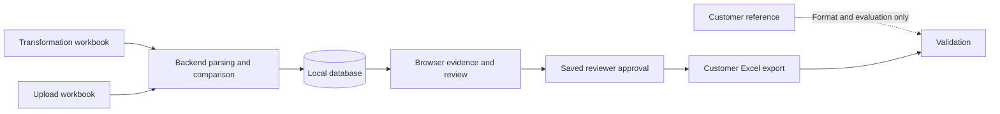

# Understanding TraceSync as we build

## Start with the business problem

A transformation lead has two technical reports describing different stages of work and must decide what to tell a customer. TraceSync is intended to organize that evidence, show what corresponds, and let the lead approve a final Excel report. Its value comes from reducing repetitive comparison while keeping decisions traceable.

There are three workbook roles:

- **A, transformation:** findings before/around remediation checks.
- **B, upload:** object-level outcomes plus a detailed technical log after upload attempts. The supplied copy also contains manual annotations.
- **C, customer reference:** an example of the report a person previously curated. It helps establish format and evaluate results, but will not be required to process a new pair of inputs.

Think of A and B as evidence and C as a previous reviewed deliverable. Copying decisions from C into automatic rules and then testing against C would make the evaluation misleading.

## The most important distinction

Suppose an imaginary program `Z_DEMO_ORDER` appears in both reports. A says its transport layer is missing; B says it is locked by a transport request. The object may be the same, but the findings differ. The business decision—include, exclude, or recheck—still needs a rule or reviewer.

Keep four questions separate:

| Question | Example answer | Why it matters |
|---|---|---|
| Are these records about the same object? | Exact type/name match | Establishes identity |
| How do their findings compare? | Different category | Describes evidence |
| What should happen to this finding? | Recheck | Records business disposition |
| Has the decision been approved? | Draft | Controls customer export |

One object can have many messages, and one message can discuss a component of a larger object. Several objects might share a blocker, but matching the generic error label alone does not prove a common cause.

## Out-of-scope objects and the customer decision

You clarified that out-of-scope objects must be reported to the customer for revalidation and a decision on access before the second run. This gives us a concrete business requirement: retain those entries in the reviewed customer-report workflow, with an explanation/request approved by the reviewer.

You then defined `Out of scope`: the object is not present in the TR shared with the transformation team, so the team currently cannot see or access it in this workflow. This is recorded as BR-002 in [mapping-rules.md](mapping-rules.md). The app would need authoritative TR-membership evidence or a reviewed decision to apply this definition. An object missing from one of our two Excel reports is not enough evidence of absence from that TR.

For an imaginary out-of-scope object, the report can ask the customer to revalidate it and decide whether to provide access. You confirmed that customers usually add it to the shared TR or provide another TR (BR-003). Approving that report internally only approves what we communicate. It does not establish that the customer has made the change or that access is available. Who decides, what proves availability, and how to handle a denial or missing response remain questions for your seniors.

The label describes a scope/access situation; inclusion describes whether the customer needs to see the entry. Keeping these concepts separate prevents a report filter from hiding an object that needs a customer decision. The requirement is recorded as [BR-001](mapping-rules.md).

Use [SENIOR_QUESTIONS.md](SENIOR_QUESTIONS.md) at each stage. We will turn answers into dated rules and small acceptance examples, so you can explain both the implementation and the business reason behind it.

## What we did in this step, and why

1. **Inspected the existing repository.** A repository is the folder Git uses to track versions of project files. This one already existed, so we preserved it. Git tracks files, which is why small `.gitkeep` placeholders retain empty future folders.
2. **Read the specification and the real workbooks.** A specification describes the intended system; discovery checks its assumptions. We found that the sample directory differs from the proposed path, detailed messages have blank subjects and padded text, and specific-looking upload categories are manual labels.
3. **Counted records and recorded schemas.** A schema describes fields and their types: for example, `Object Name` is text and `S.No` is an integer. A worksheet's formatted size is not its number of actual records. The dictionary records the real columns and missing values so the future parser does not guess.
4. **Investigated possible keys.** A key identifies something. `(object type, object name)` combines two fields to identify a proposed object; a workbook/sheet/row location identifies a particular evidence record. These solve different problems. `S.No` restarts repeatedly, so it cannot identify a global record.
5. **Separated observations from decisions.** Seeing 203 message blocks is an observation. Deciding that every message in a block belongs to its terminal object is a rule requiring validation. Discovery proposes the rule without silently implementing it.
6. **Documented the next small steps.** Each milestone has something concrete to demonstrate and verify. This keeps the project manageable for one developer.

The inspector was the only executable utility created during Prompt 0.1. It reads workbook structure and reports metadata; it does not decide matches or customer actions. SHA-256 is a content fingerprint: equal before/after fingerprints verify that the original file bytes did not change during inspection. A hash does not prove business correctness or remove sensitive information.

## What Prompt 0.2 adds

The backend foundation now runs as **TraceSync API**. `/api/v1/health` asks whether the HTTP service is running; `/api/v1/ready` asks whether it can connect to the database. Readiness does not yet check schema currency or customer access. Swagger at `/docs` lets you inspect these endpoints without building a frontend.

Pydantic Settings reads safe defaults, your ignored root `.env`, and environment overrides. A virtual environment keeps this project's installed packages separate from global Python. SQLAlchemy provides a session for a unit of database work; Alembic applies an explicit, versioned schema migration. We created only a `Project` table, with UUID identifiers and UTC timestamps, because the current task does not require the future reconciliation tables. Application startup never creates tables automatically.

The 25 foundation tests exercise real behavior using temporary databases and synthetic values. They do not touch the original workbooks or the development database. A request ID ties a response to metadata logs without logging customer messages or request credentials. See [backend/README.md](../backend/README.md) for commands and verification results.

## What Prompt 0.3 adds

You can now create a project and cycle, upload each source workbook, and retrieve its saved evidence. Three small adapters translate the known worksheet layouts into structured records. A separate persistence service saves the workbook metadata and all rows in one **transaction**: everything succeeds together, or the database rolls back the upload. Re-uploading identical bytes returns the existing workbook; different bytes for the occupied role require a new cycle.

Raw evidence and normalized keys answer different questions. Raw text shows exactly what the source cell said, including its whitespace; normalized keys make later comparisons consistent. A normalized key is not a match result, a customer decision or evidence of access. Manual annotations remain separate from the tool's outcome. Excel row numbers make it possible to go back to the original cell.

The default tests and demo workbooks use fictional data generated from committed Python source. A second Windows laptop can install the declared dependencies, run migrations to create its own database, and generate those inputs without company files. An automated test exercises a fresh source copy under a different folder name with spaces and outbound network calls blocked. Initial installation still needs package access, and an actual second laptop has not been tested. Prompt 0.3 adds no Docker or setup/launch scripts.

## How the future application fits together

The **frontend** runs in the browser. It displays files, tables and evidence, and sends user actions to the backend. The **backend** runs locally as a service: it reads Excel files, applies validated rules, saves decisions and creates downloads. An **API** is the agreed request/response interface between them, usually using HTTP and JSON. For example, a future upload endpoint receives a file and returns import counts and warnings.

The **database** remembers projects, cycles, source records and decisions between sessions. Raw evidence is stored separately from a reviewer's edits so we can answer, “What did the report originally say, and who changed the customer description?” That history is an audit trail. **Provenance** means the location and origin of evidence: workbook, sheet and Excel row.

## Technology choices in plain language

| Technology | What it does | Reason for using it here |
|---|---|---|
| Python | Runs backend processing code | Suitable for workbook processing and explicit, testable rules |
| OpenPyXL | Reads/writes Excel cells, sheets and formatting | Discovery needs actual cells, headers and layout; later export needs workbook formatting |
| pandas | Organizes tabular data for analysis | Useful later for some comparisons; not necessary for this inspector |
| FastAPI | Handles web requests in Python | Connects browser actions to backend processing |
| Pydantic | Checks typed input/output structures | Prevents malformed requests from silently becoming inconsistent records |
| React | Builds browser interfaces from reusable components | Tables, upload controls and evidence panels can share behavior |
| TypeScript | Adds type checking to JavaScript | Helps catch incompatible UI data shapes before runtime |
| Vite | Runs/builds the frontend during development | Provides a focused frontend development setup |
| Tailwind CSS | Supplies styling utilities | Helps make a consistent interface without a large custom style system |
| SQLite | Stores structured data in a local database file | Enough for the initial single-user demo, without a separate database server |
| SQLAlchemy | Maps Python operations to relational database operations | Keeps persistence organized and supports later database changes |
| Alembic | Versions database structure changes | Lets us evolve tables deliberately without recreating the database each time |
| pytest and httpx | Verify Python rules and HTTP behavior | Check meaningful processing and API cases |
| Vitest and React Testing Library | Verify frontend behavior | Check user interactions such as inspecting and saving a decision |
| Docker Compose | Starts a defined set of app services | Useful later for repeatable setup, after local commands work |
| PostgreSQL | Runs a shared database server | A possible later choice for concurrent users and deployment requirements |

The backend dependencies are installed in an isolated Python 3.12 environment, including Pydantic Settings, multipart upload support and XML protection. Frontend tools, Docker, PostgreSQL and AI remain future choices. OpenPyXL now parses source workbooks through the API; pandas is available but not needed for these adapters. We will explain the code for each new workflow when it is introduced.

## Engineering terms you will encounter

- **Normalization:** making a separate comparison value, such as trimming `PROG      ` to `PROG`. Keep the original value as evidence. Do not remove meaningful identifier characters to force a match.
- **Adapter:** a small translator for one source layout. If a future report changes headers, we can update its adapter while preserving the common processing model.
- **Deterministic rule:** the same inputs and rule version produce the same answer. It is easier to explain and verify than an unsupported guess.
- **Human in the loop:** the application assists comparison, while a person approves business decisions that the data alone cannot establish.
- **Unit test:** checks one isolated behavior, such as handling a padded type code. **Integration test:** checks connected behavior, such as upload → storage → evidence retrieval.
- **Fixture:** a small example input with known expected behavior. Synthetic fixtures teach and test the system without committing customer records.
- **Idempotence:** repeating an operation does not create accidental duplicate results. Reconciliation will need a clear policy for reruns and existing reviewer decisions.
- **Precision and recall:** precision asks how many accepted answers were correct; recall asks how many verified correct answers were found. Both require verified expected answers. A count of matching names is neither metric.
- **MVP:** the smallest useful complete workflow. For TraceSync it is upload → reconcile → review → export, with traceability.

## Why AI comes later

The spreadsheet already contains facts and identifiers. Our first job is to preserve and compare them reliably. A later AI helper might explain selected technical evidence, but its explanation would be a suggestion. It would not approve customer actions or create matching facts. Smart Blocker Radar can also work without AI by finding the same explicit transport-layer or request identifier in evidence for several objects.

The best additions suggested by discovery are practical: clear import warnings, a queue for unsupported message links, explicit source/manual label separation, and a reliable synthetic demo. Cross-cycle history and optional explanations become more useful after the first complete workflow is dependable.

## Explain the current stage to a panel

> TraceSync will help leads turn two technical Excel reports into a traceable, reviewed customer report. We inspected all seven worksheets, built the local API/database foundation, and now ingest both source reports while preserving messages, annotations and source rows. Original ingestion matches the observed 361 / 205 / 1,226 records; portable synthetic tests also run without company files. The 172 common type-and-name identities and 203 observed message blocks remain discovery evidence, not implemented matching or proven remediation outcomes. Comparison, human review and approved export are next. We have not measured automation accuracy or review-time savings.

This describes the work honestly: discovery, foundation and ingestion are complete; reconciliation and customer decisions are still to be built, and future impact will be measured rather than assumed.
